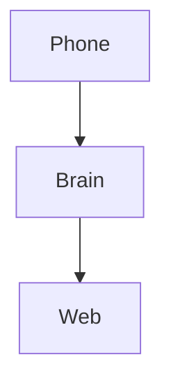

# Golden page — every block the editor can make

This page exists so the phone can prove it renders every construct the web editor produces. Body text with **bold**, *italic*, ~~struck~~, `inline code`, a [themed link\](]{color=chart-2}[[https://example.com](https://example.com)]{color=chart-2}[), ]{color=chart-2}==[a highlight]{color=chart-2}==[, \[a chart-2 colour span]{color=chart-2} and [a highlighted span]{highlight=chart-4}.

## Headings

### Level three

### Level four

## Lists

- Bullet one
- Bullet two with a nested list

  - Nested bullet
  - Another nested bullet

    1. Numbered inside nested
    2. Second numbered
- Bullet three

1. Ordered one
2. Ordered two
3. Ordered three

- [ ] Open task item
- [x] Done task item
- [ ] Another open one with **bold** text

## Quote and rule

> A blockquote, with a second line
> that keeps going.

---

## Table (six columns)

| Site | Store | Status | Owner | Due | Notes |
| --- | --- | --- | --- | --- | --- |
| PS3 | 208 | Open | Alex | 2026-10-01 | Earth strap on cabinet 2 |
| PS3 | 211 | Done | Sam | 2026-09-12 | Signed off |
| VR | 214 | Blocked | Jordan | 2026-09-30 | Waiting on the utility |
| VR | 217 | Open | Alex | 2026-10-15 | `code in a cell` and $x^2$ |

## Callouts

:::info
An **info** callout with a [link](https://example.com).
:::

:::success
A success callout.
:::

:::warning
A warning callout.
:::

:::danger
A danger callout.
:::

## Aside and columns

:::aside chart-3
An aside on chart-3, with *emphasis* inside.
:::

:::columns
Left column with a list:

- one
- two
+++
Right column with a callout:

\:::info
Nested callout in a column.
:::

\:::

## Math

Inline $E = mc^2$ in a sentence, then a block:

$$\int_0^\infty e^{-x^2}\,dx = \frac{\sqrt{\pi}}{2}$$

## Code in three languages

```dart
void main() {
  final greeting = 'hello';
  print('$greeting, world');
}
```

```typescript
export function solveInk(anchor: string, surfaces: string[]): string {
  const ratio = 4.5;
  return scan('lightness', anchor);
}
```

```bash
fvm flutter test && echo "green"
```

## Mentions

A node mention of a note: [Jackdaw Colours](mention:node:916d094a-d901-402e-a1f1-8994eea8257c), a node mention of a task: [Re-port the colour themes](mention:node:b0a6e39e-59a4-4eec-b66f-89c3e07b6f79), and an entity mention: [Jason Schoeman](mention:entity:1aa6287a-87c9-443c-99e0-1c99467a5f90).

## File embed

[jackdaw-brand.md](media:8cc116ef-3f54-4097-a6c3-80af2e9da3a2)

## Child page

[The client repos](page:64b3255b-927f-46eb-a4f2-0e04d8515a2d)

## Image


## Drawing


## Legacy diagram



## Internal links

An internal page link [The client repos](/pages/64b3255b-927f-46eb-a4f2-0e04d8515a2d), a node permalink [the same page via /n](/n/64b3255b-927f-46eb-a4f2-0e04d8515a2d), a web-only link [Tables](/tables), and an anchor [back to top](#golden-page).